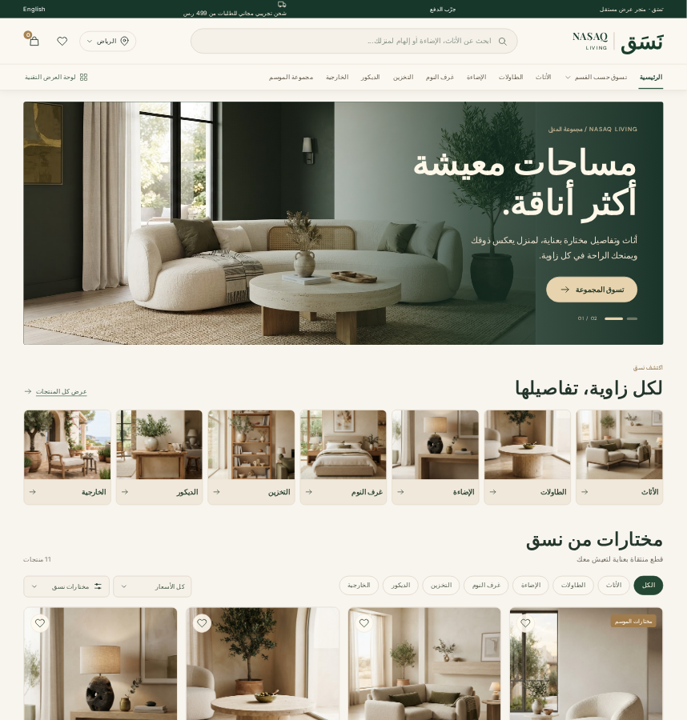
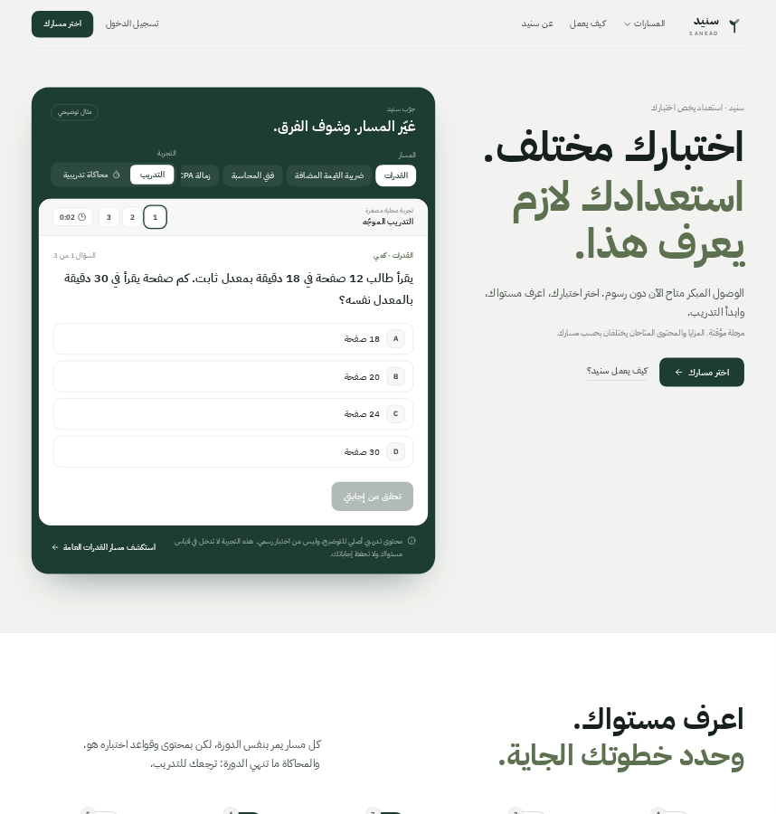
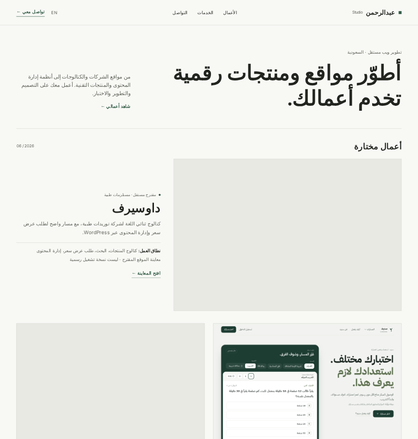
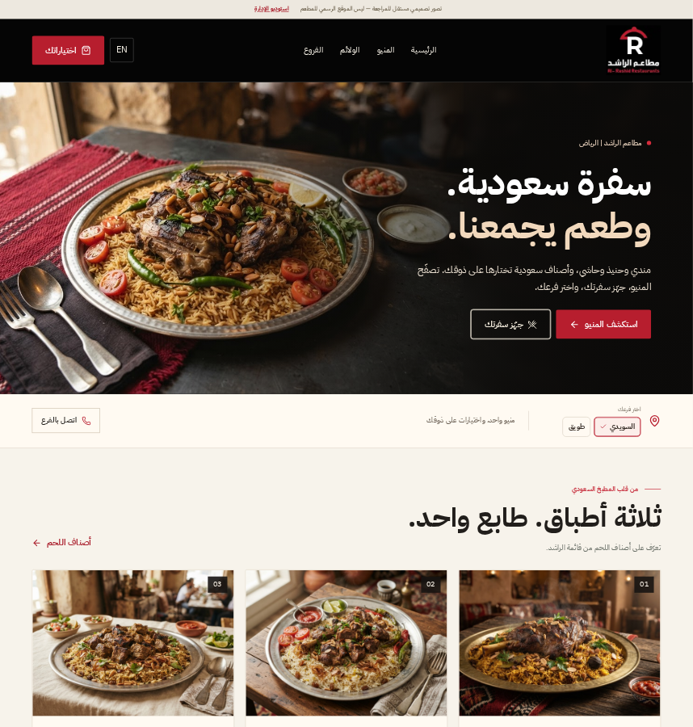

<h1 align="center">Abdulrahman</h1>

<strong>Software Quality Engineer · SaaS Founder · Web Product Development</strong>

Riyadh, Saudi Arabia &nbsp; | &nbsp; BSc Computer Science &nbsp; | &nbsp; ISTQB® CTFL

  <a href="https://abdulrahman-studio.onrender.com/"><strong>Portfolio / معرض الأعمال</strong></a> &nbsp; · &nbsp;
  <a href="https://www.linkedin.com/in/abdulrahman-alhatti">LinkedIn</a> &nbsp; · &nbsp;
  <a href="mailto:abdulrahmanalhatti@gmail.com">Email</a>

---

## About

I build and develop digital product concepts and software products, with a professional background in software quality assurance and user acceptance testing. My focus is turning business needs into usable, tested experiences — from requirements and design to implementation, release and continuous improvement.

أعمل في جودة البرمجيات واختبارات قبول المستخدم، وأطوّر منتجات رقمية ومواقع للشركات والمتاجر، مع اهتمام خاص بتجربة المستخدم وجودة التنفيذ. أستخدم أدوات التطوير المدعومة بالذكاء الاصطناعي ضمن سير عمل يشمل التخطيط والاختبار والمراجعة.

## Selected work

<table>
<tr>
<td width="50%" valign="top">

<h3>NASAQ Commerce</h3>
<strong>Custom e-commerce · Working demo</strong>

Bilingual retail experience, server-backed catalogue and checkout, order management and simulated payment.

<a href="https://nasaq-commerce-demo-khhq.onrender.com">Try the demo</a> · <a href="https://github.com/Abdulrahmnh/nasaq-commerce-showcase">Project repository</a>

</td>
<td width="50%" valign="top">

<h3>Sanead | سنيد</h3>
<strong>Education technology · Live SaaS</strong>

Certification preparation platform with guided learning, exam simulation and progress tracking.

<a href="https://sanead.com">Visit product</a> · <a href="https://github.com/Abdulrahmnh/sanead-showcase">Project repository</a>

</td>
</tr>
<tr>
<td width="50%" valign="top">

<h3>DawServe</h3>
<strong>Healthcare B2B · Independent concept</strong>

Arabic/English product catalogue, quotation-request experience and WordPress implementation.

<a href="https://dawserve-faisal-preview-1123.onrender.com">View concept</a> · <a href="https://github.com/Abdulrahmnh/dawserve-showcase">Project repository</a>

</td>
<td width="50%" valign="top">

<h3>Hospitality &amp; Digital Ordering</h3>
<strong>Food &amp; beverage · Independent concepts</strong>

Interactive menus, branch selection and mobile-first pickup ordering experiences.

<a href="https://al-rashid-preview.onrender.com">View concept</a> · <a href="https://github.com/Abdulrahmnh/hospitality-showcase">Project repository</a>

</td>
</tr>
</table>

*Images are design previews. Live products, working demonstrations and independent concepts are identified separately. Concept sites are not official commissioned client deliveries. Payment and restaurant ordering demonstrations do not process real transactions.*

[Explore more projects in my bilingual portfolio](https://abdulrahman-studio.onrender.com/).

## Engineering showcase

Explore project-level architecture, scope, design screenshots and quality evidence in the [public project showcase](showcase/packages/README.md), or open the dedicated repositories above. The commercial implementations remain private.

## What I work on

| Area | Focus |
| --- | --- |
| Product development | Business requirements, prototypes, web applications, SaaS and e-commerce |
| Software quality | UAT, functional and regression testing, API validation, defect reporting |
| Delivery | GitHub, deployments, release verification and continuous improvement |
| User experience | Arabic/English interfaces, responsive layouts and customer journeys |

## Technology exposure through projects

React · TypeScript · JavaScript · HTML/CSS · Python/FastAPI · PostgreSQL · WordPress/PHP · GitHub · Docker · Render

## Education & professional certification

- Bachelor of Science in Computer Science
- ISTQB® Certified Tester Foundation Level (CTFL)

## Earlier learning projects

My public repositories also include earlier programming exercises and learning projects, including [BMI Calculator](https://github.com/Abdulrahmnh/BMI-Calculator), [Quiz App](https://github.com/Abdulrahmnh/Quiz_App) and [Library CLI](https://github.com/Abdulrahmnh/LibraryCliApp). These represent my learning journey rather than my current product portfolio.

---

Product thinking · Quality by design · Continuous learning

