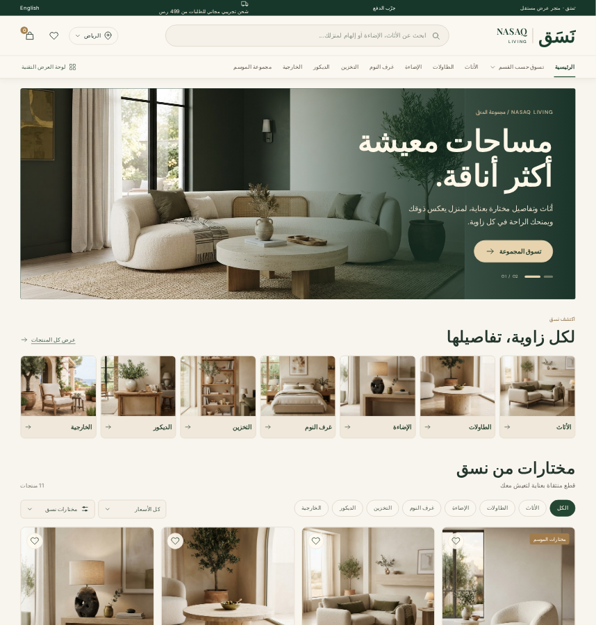

# NASAQ Commerce

**Independent working demo** · [Open experience](https://nasaq-commerce-demo-khhq.onrender.com) · [Back to profile](../README.md)

## Business objective

Demonstrate a custom retail storefront and a realistic purchase journey for Saudi merchants.

## Implemented or demonstrated scope

- Responsive bilingual storefront, product variants, cart, discounts and fulfilment options.
- Server-backed demo catalog, availability, price quotation and order creation.
- Hosted-style payment simulation, including success, decline and pending outcomes; no real payment provider or bank data.

## Technologies

React, TypeScript, Python / FastAPI, Docker, Render

## My contribution

Product direction, requirements, implementation coordination, QA and deployment using AI-assisted development.

## Scope and transparency

Independent demonstration, not an official payment-provider integration. The screenshot is from the design prototype; the linked demo runs the server-backed implementation. No real charges or payment credentials.
