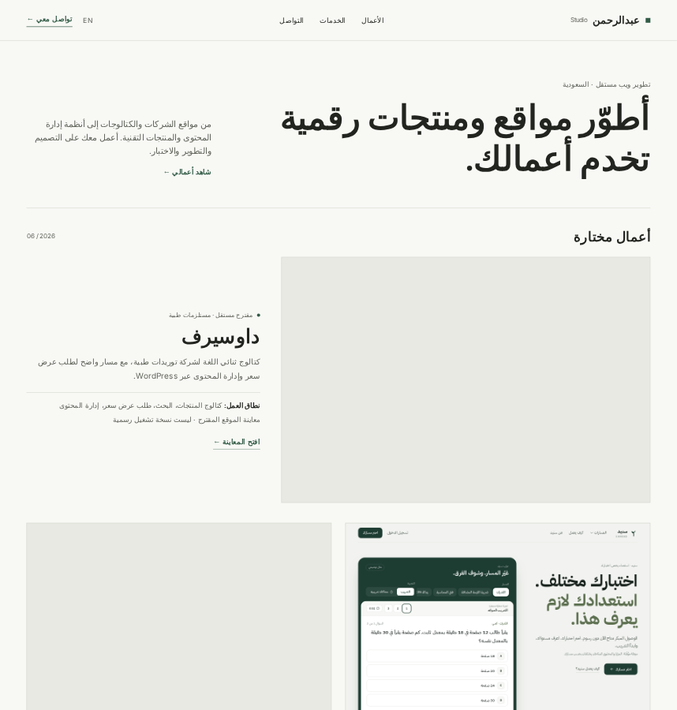

# DawServe

**Independent B2B website concept** · [Open experience](https://dawserve-faisal-preview-1123.onrender.com) · [Author profile](https://github.com/Abdulrahmnh)

## Business objective

Explore how a medical-supply business can make its catalogue easier to browse and convert interest into quotation requests.

## Implemented or demonstrated scope

- Arabic and English catalogue with responsive product discovery.
- Request-for-quotation journey.
- Separate WordPress implementation with custom theme, product management and RFQ validation.

## Technologies

WordPress, PHP, HTML/CSS, JavaScript

## My contribution

Concept, requirements, implementation coordination, and functional and responsive QA.

## Scope and transparency

Independent concept and preview, not an official commissioned or paid client delivery. The linked preview is not the full WordPress administration environment.

## Engineering documentation

[Architecture and verification](docs/architecture.md)

This showcase contains public-facing documentation and design imagery only; the product source remains private.
