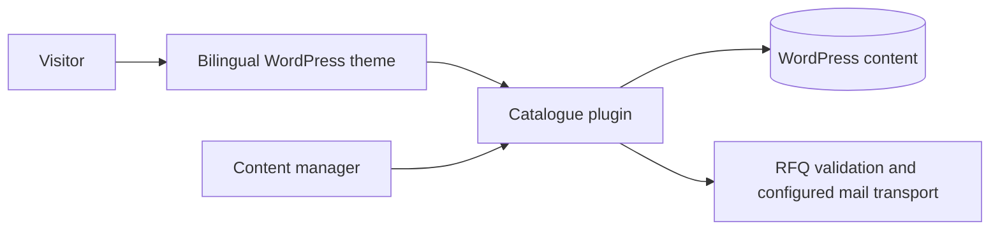

# Architecture & verification

The custom theme owns responsive presentation. A separate plugin manages published products, categories, bilingual fields and quotation requests. The static concept preview is distinct from the WordPress implementation.

## Documented local QA evidence

| Historical check | Recorded result |
| --- | --- |
| Catalogue and navigation | 7 scenarios per browser engine |
| RFQ and administration | 10 scenarios per browser engine |
| Visual comparison | 12 captures across viewport and locale pairs |
| PHP lint, coding standards and package checks | Passed |

The documented browser runs used Chromium and WebKit. Test email delivery used a local SMTP fixture, not production mail. Physical-device staging, live hosting and operational verification are separate gates. No fresh test run is claimed.

Independent concept, not a commissioned production delivery.
