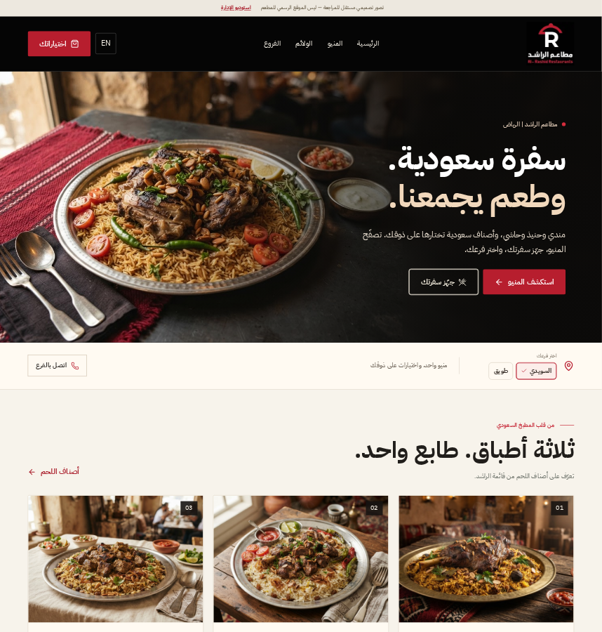

# Hospitality & digital ordering

**Independent restaurant concepts** · [Open experience](https://al-rashid-preview.onrender.com) · [Author profile](https://github.com/Abdulrahmnh)

## Business objective

Explore a lower-friction digital menu and order-ahead experience for restaurants.

## Implemented or demonstrated scope

- Interactive menus, branch selection and pickup journeys.
- Mobile-first layouts and bilingual experiences.
- Simulated ordering; no live orders, payments or POS connection.

## Technologies

React, TypeScript, responsive web UI

## My contribution

Product concept, interaction design, implementation coordination and QA.

## Scope and transparency

Independent concepts, not endorsed restaurant websites or paid client deliveries. Screenshot is a design preview. Additional example: https://abdulaziz-grills-preview.onrender.com

## Engineering documentation

[Architecture and verification](docs/architecture.md)

This showcase contains public-facing documentation and design imagery only; the product source remains private.
