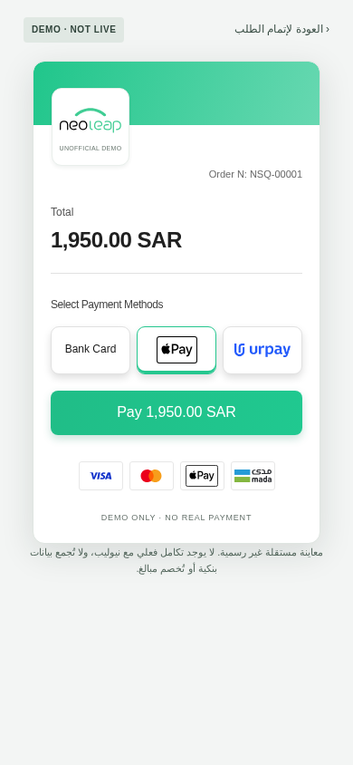

# NASAQ Commerce

**Independent working demo** · [Open experience](https://nasaq-commerce-demo-khhq.onrender.com) · [Author profile](https://github.com/Abdulrahmnh)

## Business objective

Demonstrate a custom retail storefront and a realistic purchase journey for Saudi merchants.

## Implemented or demonstrated scope

- Responsive bilingual storefront, product variants, cart, discounts and fulfilment options.
- Server-backed demo catalog, availability, price quotation and order creation.
- Hosted-style payment simulation, including success, decline and pending outcomes; no real payment provider or bank data.

## Mobile checkout preview

The design preview shows the payment-method selection screen. On the linked API-backed demo, the server validates the quote and creates a simulated order. No real payment is initiated.

## Engineering & quality approach

- The storefront and merchant workspace use a same-origin API.
- The server calculates pricing and checks inventory; checkout uses an idempotency key to prevent duplicate order creation on retry.
- Guest order access is session-scoped. Merchant administration requires separate authorization in the demo.
- The existing automated backend test suite contains 20 named scenarios covering server pricing, shipping, stock contention, idempotency, guest isolation, payment outcomes, fulfilment and quote rollback. These are implemented tests, not a claim of a fresh passing run or production certification.

| Sample verification scenario | Expected behavior |
| --- | --- |
| Price changes before checkout | Revalidate the total before creating an order |
| Same checkout retried | Reuse the original order intent |
| Insufficient stock | Reject the invalid order without overselling |
| Declined simulated payment | Preserve the ability to retry |
| Pending simulated payment | Resolve the existing order instead of creating another |
| Guest accesses another guest's order | Reject unauthorized access |

## Technologies

React, TypeScript, Python / FastAPI, Docker, Render

## My contribution

Product direction, requirements, implementation coordination, QA and deployment using AI-assisted development.

## Scope and transparency

Independent demonstration, not an official payment-provider integration. The screenshots are from the design prototype; the linked demo runs the server-backed implementation. No real charges or payment credentials.

## Engineering documentation

[Architecture and verification](docs/architecture.md)

This showcase contains public-facing documentation and design imagery only; the product source remains private.
