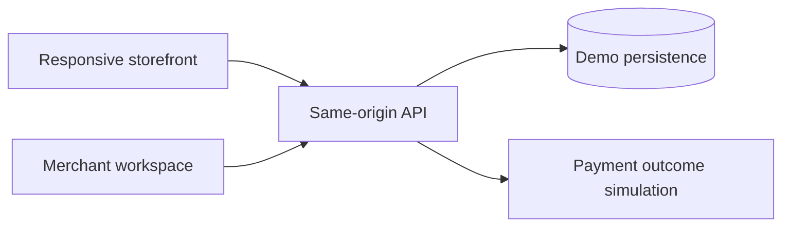

# Architecture & verification

## High-level system

React and TypeScript provide the storefront and merchant workspace; FastAPI handles server-side quotes, inventory and order creation. Docker packages the demo.

The checkout flow revalidates prices, preserves an idempotency key on recovery and limits guest access to session-scoped orders. Payment selection is illustrative; it does not connect to a live provider.

## QA coverage

The existing backend suite contains 20 scenarios, including server-calculated prices, stock concurrency, duplicate requests, guest isolation, and simulated payment outcomes. A historical SQLite run recorded 20 passes. No fresh test execution is claimed here. Production payment integration, production access controls and full release verification remain separate work.

This is public-safe documentation only. No proprietary source code, tokens or deployment configuration is included.
